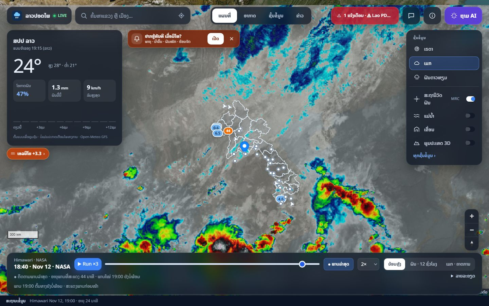

# ລາວປອດໄພ — Lao Weather & Disaster Watch

ເວັບແຜນທີ່ອາກາດ ແລະ ໄພພິບັດ ຂອງ ສປປ ລາວ ເປັນພາສາລາວ — ພາບດາວທຽມ, ເຣດາ, ຝົນ, ລະດັບນ້ຳ, ເຂື່ອນ ແລະ ແຈ້ງເຕືອນ ໃນແຜນທີ່ດຽວ.

🌐 **ເວັບຈິງ:** https://lao-weather-watch.sonexaivanlaty01.workers.dev

## ເຮັດຫຍັງໄດ້
- ແຜນທີ່ພາບເມກ (Himawari) ແລະ ເຣດາຝົນ ຫຼິ້ນເປັນພາບເຄື່ອນໄຫວ
- ພະຍາກອນອາກາດ ແຍກຕາມແຂວງ ເປັນພາສາລາວ
- ລະດັບນ້ຳແມ່ນ້ຳຂອງ, ສະຖານີວັດຝົນ ແລະ ເຂື່ອນ
- ແຈ້ງເຕືອນໄພພິບັດ ແລະ ການແຈ້ງເຕືອນເທິງມືຖື (Web Push)
- ອັບເດດຂໍ້ມູນເອງ ທຸກ 30 ນາທີ

## ເຕັກໂນໂລຢີ
Cloudflare Workers · KV · D1 (SQL) · R2 · Cron Triggers · Browser Rendering · MapLibre GL · Open-Meteo / NASA GIBS / MRC data

## ສ້າງແນວໃດ
ອອກແບບ, ສ້າງ, ທົດສອບ ແລະ ປັບປຸງ ຮ່ວມກັບ AI Coding Tools (Claude Code).
ໄຟລ໌ `verify-*.mjs` ແມ່ນການທົດສອບອັດຕະໂນມັດ ທີ່ໃຊ້ກວດກ່ອນອັບເດດເວັບທຸກຄັ້ງ.

## ໂຄງສ້າງ
| ໂຟນເດີ | ໜ້າທີ່ |
|---|---|
| `cloudflare-site/` | ເວັບຫຼັກ (ໜ້າເວັບ + API) |
| `worker/` | ໂຄດຮ່ວມ: ດຶງຂໍ້ມູນ, SEO, ພະຍາກອນ |
| `cloudflare/` | ລະບົບດຶງພາບດາວທຽມຕາມເວລາ |
| `converter/` | ແປງຂໍ້ມູນພາບ |

ຄີລັບທັງໝົດ (Admin key, Web Push key, API keys) ເກັບໄວ້ໃນ Cloudflare Secrets — ບໍ່ຢູ່ໃນ repo ນີ້.

---

**English:** A Lao-language weather and disaster map for Laos (satellite, radar, rain, river levels, dams, alerts), auto-updating every 30 minutes on Cloudflare Workers. Built entirely by directing AI (Claude Code). Secrets live in Cloudflare Secrets, not in this repository.

**ຜູ້ສ້າງ / Author:** ສອນໄຊ ວັນລາຕີ (Sonexay Vanlaty)
